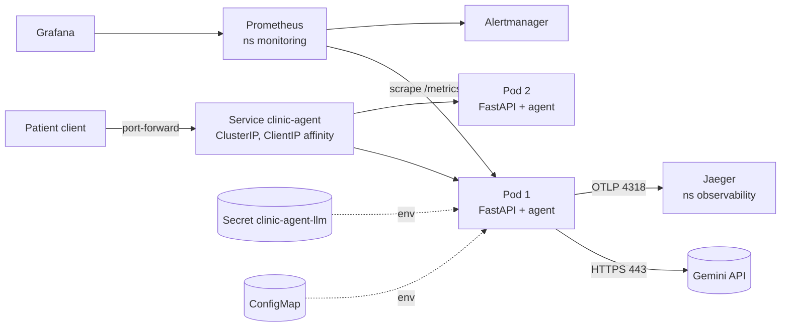

# Architecture and operation

## Components

| Component | What it is | Where |
|---|---|---|
| `service/` | FastAPI app wrapping the agent: sessions, `/healthz`, `/readyz`, `/version`, `/metrics` | Deployment `clinic-agent`, namespace `clinic` |
| `agent/` | The agent loop, tools and guards (unchanged logic) | inside each pod |
| Clinic database | In-memory SQLite, one per chat session (demo data) | inside each pod's memory |
| Gemini API | The language model (external) | internet, HTTPS |
| ConfigMap | Model provider, policy version, limits, tracing endpoint | namespace `clinic` |
| Secret `clinic-agent-llm` | `GEMINI_API_KEY`, created by `scripts/create-secret.sh` | namespace `clinic` |
| kube-prometheus-stack | Prometheus, Alertmanager, Grafana, kube-state-metrics | namespace `monitoring` |
| Jaeger | Trace collector and UI | namespace `observability` |

## Request path (one patient message)

1. Client `POST /v1/sessions/{id}/messages` -> `kubectl port-forward` -> Service `clinic-agent` (port 80).
2. The Service picks a ready pod; `sessionAffinity: ClientIP` keeps the same client on the same pod,
   because the chat (and its clinic database) lives in that pod's memory.
3. Middleware gives the request an id, starts a timer and (if tracing is on) a trace span.
4. `agent.respond()` loops: call Gemini -> run tools (verify, search, book...) against the session's SQLite -> repeat.
   Every model call is timed and counted (`clinic_llm_*`); every tool call is read back from the audit table
   and counted (`clinic_tool_calls_total`, `clinic_writes_committed_total`).
5. Reply returned as JSON with `writes_committed` so the client (and the smoke test) can check state, not words.
6. One JSON log line per request (no patient text) on stdout; the span is exported to Jaeger.

## Failure boundaries

| Failure | What happens | Who notices |
|---|---|---|
| Gemini slow or down | Retries with backoff inside the pod, then HTTP 503 `Retry-After: 10`; the pod stays ready (an outside outage should not take pods out) | `clinic_llm_calls_total{outcome="infra_error"}`, alert ClinicAgentModelUnavailable |
| API key missing or wrong secret | Pod runs but `/readyz` returns 503 with the reason; no traffic is sent to it; a deploy waits and Helm rolls back | `helm --atomic` rollback, alert ClinicAgentNoReadyPods |
| Pod crashes or hangs | Liveness probe restarts it; the Service routes to the other replica | restarts in `kubectl get pods`, Grafana |
| Pod deleted / node drained | The other replica serves; PodDisruptionBudget keeps at least one pod; chats on the lost pod are lost (in memory) | known limitation |
| Too many chats in one pod | New chats get 503 `Retry-After: 30` instead of running out of memory | `clinic_active_sessions` |
| Bad release | Rolling update keeps old pods until new ones are ready (`maxUnavailable: 0`); `--atomic` undoes a failed upgrade; `helm rollback` for a release that is up but wrong | `/version`, smoke test |

## Linux, networking and cloud concepts used

- **Processes and users:** the container runs as uid 10001, not root; the root filesystem is read-only, only `/tmp` is writable (an `emptyDir`).
- **Signals:** on shutdown Kubernetes runs `preStop: sleep 5` (so the Service stops sending traffic first), then sends SIGTERM; uvicorn finishes in-flight requests.
- **Networking:** ClusterIP Service (virtual IP inside the cluster), DNS names like `jaeger.observability.svc.cluster.local`, NetworkPolicy as a firewall between pods (allow DNS, HTTPS out, OTLP to Jaeger, scrape from monitoring).
- **Cloud mapping:** on a managed cluster (EKS/GKE) the same chart works; the Secret would come from the cloud secret manager and the Service would sit behind an authenticated ingress or load balancer.
